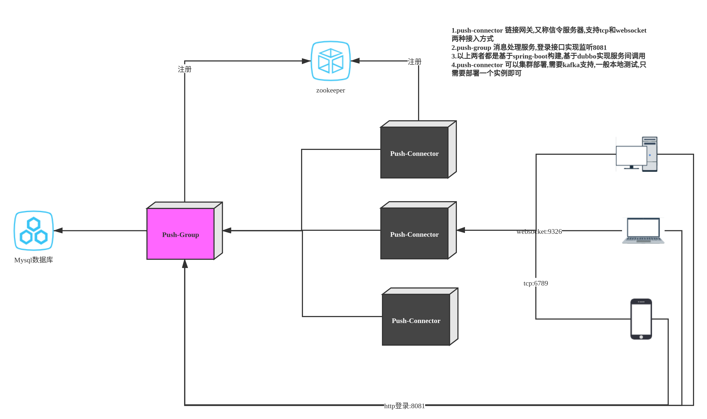

# 飞享

# 版本自动编译流程
```
# 只有提交tag命令，才会触发提交
git commit -m ""
git tag v***
git push && git push --tags
```

## 更新日志

## 0.9.9-dev
* 此版本需要服务端2.2.0之后版本支持
* 发送消息增加local_messageId


## 0.9.9
* 调整打开主界面发送心跳测试的超时时间间隔，避免长时间无法检测
* 强制重联重置heartbeatManager
* 白天模式切换避免出现夜间模式时间间隔随机
* 发现重连两次才出现数据链路正常
* 变更网络强制重连
* 白天模式每隔3小时自动重连
* 增加集群模式连接自动切换功能
* 优化网络连接监听机制，避免重复网络信息回调导致的重复连接

### 0.9.8 [989]
* 增加国内上海的coturn服务
* 增加主进程日志打印,各个进程日志目录区分

### 0.9.8 [988]
关于飞享修改心跳策略导致的问题分析
* 加入心跳超时重连机制，有可能在单链接通道数据传输导致心跳接收超时一直重连
* 接收数据header 在client关闭时没有重置导致可能出现重连也无法正常接收数据
修改
* 针对心跳超时增加最近时候有数据通过间隔时间超过当前心跳才触发
* 更新sequence过滤掉通话信令
* 去除无用日志打印
* 发送消息messageId增长优化
* 去除发送消息换成重试功能


### 0.8.5 版本更新[857]
* 升级SDK为31 ,需要JDK 11编译
* 代码兼容android 13,闹钟模式更新,心跳机制优化,断线之后减少心跳间隔
* 用户短信之后,重新拉取消息,弹出通知到提示
* 升级腾讯MAP,更新Key
* 升级google webrtc,Flyme 10 应用分身可能导致同一个应用获取相机是吧,必须等待一段时间.
* targetSdkVersion 降为29 防止升级导致无法读取图片


**NOTE:** 本项目为`飞享`即时通讯系统的Android客户端

## 适合快速部署的聊天系统
这是一个聊天系统的简单架构，解决大量用户需要即时通讯的解决方案，基于RPC框架Dubbo,SpringBoot构建微服务应用，提供Docker快速部署的解决方案。
提供Android客户端,Web客户端类似微信功能，包括`好友添加`，`私聊`，`群聊`，`一对一音视频通话`等基本功能

### 架构图

**NOTE:** 基本架构图说明为了帮助大家更快了解系统依赖的组件,方便大家快速本地部署



### Android 客户端
[android-chat](https://github.com/comsince/android-chat)客户端，基于java nio实现TCP长连接，使用自定义的二进制协议，全新的心跳设计，实现与web端消息同步，音视频通话等功能。

> __<font color="#dd0000">扫码体验APK下载</font>__


**NOTE:** 本apk基于[android-chat](https://github.com/comsince/android-chat)构建替换为java协议栈开发

* 请选择其中任何一个帐号密码进行登录即可
```properties
帐号：13800000000, 13800000001, 13800000002
验证码：556677
```

* 技术咨询  
  
当你登录上面其中一个测试帐号后，如果你有什么问题，请到通讯录找到`官方技术支持`发消息即可，你也可以在`IM即时通讯交流组`提问，如果在研究过程中有问题，可以随时咨询，本人尽量提供技术支持，但并不保证随时在线，请尽量在工作日时间发消息

* 官方QQ群交流


### 基于Vue的Web客户端
web客户端基于websocket通信，在此协议之上使用json格式的协议进行通讯，详情参见[vue-chat](https://github.com/comsince/vue-chat),支持文本，图片类型发送，支持实时音视频，支持音视频与[android-chat](https://github.com/comsince/android-chat)客户端互通


* 项目预览  


* 语音通话


* 视频通话


**NOTE:** [演示地址](http://www.comsince.cn/chat/index.html) 演示`账号`,`验证码`同手机版一致.由于这里使用的是http服务，chrome浏览器对非https的权限管控，建议使用edge浏览器测试音视频通话，当然你也可以本地部署

#### Vue-Chat公测地址

* 公测地址[chat.comsince.cn](https://chat.comsince.cn)
**NOTE:** 注意`公测地址`与`演示地址`两套环境是独立的，数据不互通，公测环境请使用手机号+验证码登录，如需技术支持或意见反馈请加好友`13900000001`官方技术支持,公测地址带宽只有1M,首次加载可能需要时间比较长，请耐心等待

## 服务说明
聊天系统为了适应大规模用户的链接请求，将服务分为`链接服务`和`消息服务`，它们都是独立的，可以单独部署也可以集群部署
### 链接服务[push-connector]
用于解决用户的链接请求，支撑百万级用户的链接，可单机部署，可集群部署。如果你存在大规模用户链接，可以启动集群模式,参考[K8s自动伸缩模式](#k8s_deployment)
### 消息服务[push-group]
用于用户处理用户管理，会话管理，离线消息处理，群组管理等功能，是整个即时通讯系统的业务处理模块

## 自动化构建
增加持续集成的好处
* 随时随地发布软件
* 任何一次构建都能触发一次发布
* 只需发布一次artifact,即可随时发布

**NOTE:** 以下是发布持续交付工作流图


## 如何启动服务
本机部署只需要两个`SpringBoot`服务，一个`Mysql`服务，一个`zookeeper`服务,链接服务`push-connector`集群模式还需要`kafka`支持

### 部署前准备
* 安装`docker`与`docker-composer`,如果需要在k8s中部署，请准备好相关的环境
* 确保编译此项目`mvn clean package -Dmaven.test.skip=true`

### 生产模式
这种模式下，所有的镜像都会从Docker Hub下载，只需要复制`docker-compose.yml`,在该目录下执行`docker-compose up`即可.
如果要查看完整的部署步骤，请参考这里[基于Docker的即时通讯系统的持续集成发布说明](https://www.comsince.cn/2019/08/07/docker-continuous/#%E4%BB%8Edocker-hub%E4%B8%8B%E8%BD%BD%E9%95%9C%E5%83%8F%E5%8F%91%E5%B8%83im%E7%B3%BB%E7%BB%9F)

### 开发模式
如果你希望自己编译镜像，你必须克隆此代码，并在本地编译此项目。然后执行`docker-compose -f docker-compose.yml -f docker-compose-dev.yml up`  

### K8S中部署<a name="k8s_deployment"/>
如果想在k8s中部署，我们也提供yml配置，执行以下命令即可，详情参考[即时通讯服务在k8s容器的部署说明](https://www.comsince.cn/2019/08/12/universe-kubenetes-intro/)
```shell
kubectl apply -f https://www.comsince.cn/download/cloud-native/universe-kube-deployment.yml
```
或者下载代码执行,`push-connector`支持扩展，以适应海量长连接，集群模式需要`kafka`支持，如果kafka没有启动成功，可以手动重启`push-connector`
```shell
kubectl apply -f ./universe-kube-deployment.yml
```


## 本地开发测试
**NOTE:** 准备好mysql与zookeeper服务，配置好相应的配置，直接启动`push-connector`和`push-group`两个spring-boot服务即可

## 虚拟机部署
**NOTE:** 如果你希望直接脚本部署，[参考脚本部署](README-Linux.md),例如如下是`push-connector`服务

* 启动`spring-boot-dubbo-push-connector`链接网关服务
```shell
/opt/boot/push-api
├── jvm.ini
├── push-connector //可执行启动脚本
└── log
   └── push-connector.log //存放日志
└── lib
   └── spring-boot-dubbo-push-connector-1.0.0-SNAPSHOT.jar //可运行的jar
```

* 执行启动服务

```shell
# 启动服务
./push-connector start
# 停止服务
./push-connector stop
```

## CentOS部署

**NOTE:** 如果你在部署中遇到问题，可以到上面演示环境找到`官方技术支持`寻求解答，也可以到QQ群需求帮助，如果你有在其他环境成功安装的经验，欢迎反馈给我们

* [即时聊天系统在Centos上单机部署实践](https://www.comsince.cn/2020/04/13/universe-push-start-on-centos/)

## Windows部署

* [即时聊天系统在Windows上单机测试部署实践](https://www.comsince.cn/2020/05/07/universe-push-start-on-windows/)

## 欢迎为此项目作出贡献
该项目是开源项目，欢迎提出建议或者提供意见反馈，如果你喜欢此项目，请点击`star`支持我们不断改进

## 感谢
此项目时在参考其他项目基础上完成，在此表示感谢
* [t-io](https://github.com/tywo45/t-io)
* [wildfirechat](https://gitee.com/wildfirechat/server)
* [webrtc_android](https://github.com/ddssingsong/webrtc_android)
* [webrtc source](https://webrtc.googlesource.com/src/+/master)
